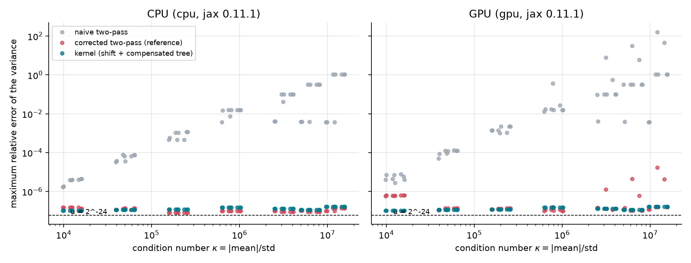
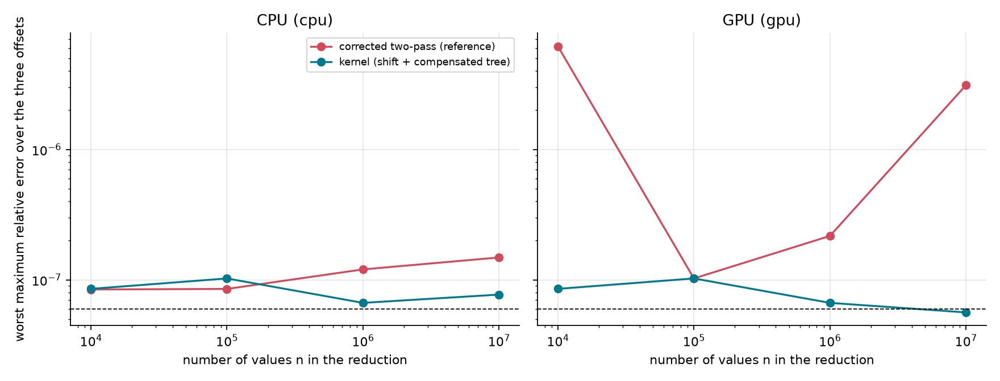
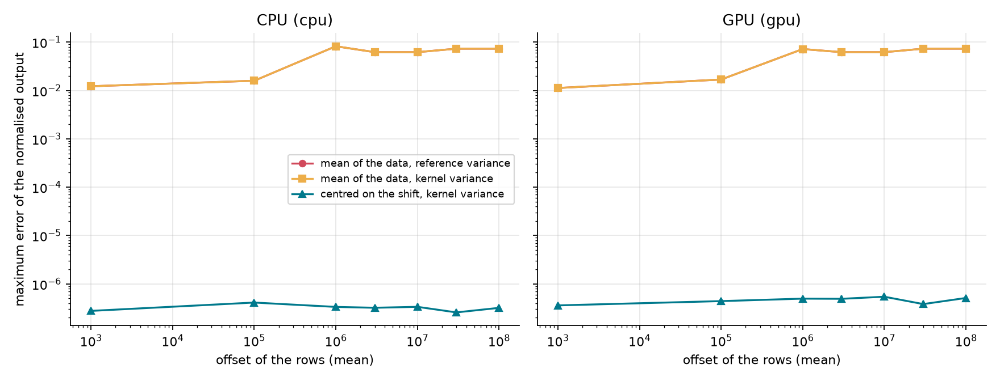

# Variance in float32 with a first-element shift, a local centring and a compensated tree sum

Salvatore Pennacchio, November 2026.

## Abstract

The variance of float32 data with a large mean and a small spread loses its digits in the subtraction `x - mean(x)`, and the loss depends on how the hardware orders the sums. We describe a kernel in four steps: a shift by the first element, a local centring, a sum of the squares by a tree of error-free `TwoSum` additions that carries the rounding errors up the tree, and a correction term. We prove that, to first order in the unit roundoff `u`, the relative error of the variance is at most `6u + 4Lu² + 4(nu(1+κ))²`, where `n` is the number of values, `L = ⌈log₂ n⌉` and `κ` is the mean of the shifted data over the standard deviation. We test it on CPU and on a GPU, on 56 offset and spread pairs, on arrays of up to 10⁷ values, and on a layer normalisation with its gradient. The kernel never exceeds 2.8 `u` and gives the same maximum errors on the two backends. The corrected two-pass formula, taken as the reference, is as accurate on the CPU (3 `u`) but reaches 292 `u` on the GPU; the naive formula loses all its digits from a condition number of about 10⁶ on the CPU and 10⁵ on the GPU. The kernel costs 2.2 times (GPU) to 3.1 times (CPU) the time of the reference. In a layer normalisation the kernel does not help by itself: the error is in the mean, and it falls from 10⁻² - 10⁻¹ to 3·10⁻⁷ only when the mean is also subtracted on the shifted data. We state the limits, among them an effect on one dataset that we could not explain.

## 1. Introduction

A float32 number has 24 significant bits, a unit roundoff `u = 2⁻²⁴ ≈ 6·10⁻⁸`. The variance of a sample whose mean is large compared with its spread, for example activations with a large offset, sensor readings or prices, is a difference of two large numbers, and the digits that remain after the cancellation are the ones that the rounding has already changed. Chan, Golub and LeVeque [1] measure this with the condition number `κ = ‖x‖₂ / √S ≈ |x̄| / σ` and survey the algorithms; two of their recommendations are the corrected two-pass formula and the shift of the data by an approximation of the mean.

The question of this paper is narrow. We take the corrected two-pass formula, `Σd² - (Σd)²/n` with `d = x - x̄`, as the reference, because it is the strongest of the simple formulas, and we ask in which regime it fails in float32 and what a kernel that adds a shift and an accurate sum buys. The answer has three parts. On a CPU, in our tests, the reference does not fail: it is as accurate as the kernel up to `κ = 1.6·10⁷`. On a GPU it does, by up to two orders of magnitude, and the kernel does not change from one backend to the other. And the kernel brings an error bound that does not depend on the order in which the hardware sums.

Contributions: (i) the kernel and a first-order error bound with a proof (Section 4); (ii) a test on two backends of the kernel, of the reference and of the naive formula, with the numbers in the tables and the scripts that produce them (Sections 5 and 7); (iii) a negative result and its correction for layer normalisation (Section 5.5); (iv) the limits (Section 6).

## 2. Related work

**Variance.** Chan, Golub and LeVeque [1] give the condition number of the sample variance, the bounds of the main algorithms (the textbook two-pass, the corrected two-pass, the updating formulas of Welford and others, the pairwise algorithm of the authors) and an analysis of the computation on shifted data: they note that even a crude estimate of the mean as a shift gives a dramatic gain, without a first pass. Our shift by the first element is such a crude estimate; what we add to [1] is the combination with a compensated sum and the test on a GPU.

**Accurate summation.** Knuth's `TwoSum` computes `x = fl(a + b)` and the exact error `y` with `a + b = x + y`, in 6 operations and without branches; Ogita, Rump and Oishi [2] show it (Theorem 3.4: `|y| ≤ eps|x|`) and analyse a cascaded sum, `Sum2`, with the bound `|res - s| ≤ eps|s| + γ²ₙ₋₁ S` (Proposition 4.5), where `s = Σpᵢ` and `S = Σ|pᵢ|`. Our sum is a tree of `TwoSum` in which the errors are carried up the tree; the term of the bound that depends on `n` goes from `(n-1)²u²` to `4Lu²` (Lemma 1).

**Shift and compensation together.** Healy [3] studies the mean and the variance in Monte-Carlo simulations, where the order of the sum changes between runs, and finds that the most accurate of the algorithms he tests is the naive formula on shifted data with a Kahan correction (his Algorithm 2). Our kernel is the same idea with the tree in place of the sequential Kahan scan; the scan is a sequential loop, and on a GPU it costs 43 times the reference in our measurement (Section 5.6), the tree 2.2 times.

## 3. The kernel

For a one-dimensional array `v` of `n` float32 values:

1. **Shift.** `y = v - v[0]`. If `v[i]` and `v[0]` are within a factor 2 of each other the subtraction is exact (Sterbenz), so `y` has no error.
2. **Centring.** `m = sum(y) / n` and `d = y - m`. The mean of the shifted data is of the order of the spread, not of the offset.
3. **Compensated tree.** `s2` is the sum of `d²` by a tree: at each level two values and two carries are added by `TwoSum`, the three errors of the level are added and become the carry of the next level; the sum and the carry are added at the root (the code is `comp_tree` in `experiments.py`).
4. **Correction.** `s1 = sum(d)` and `var = max(s2/n - (s1/n)², 0)`.

The algebra is exact: `Σ(y - m)² / n - (Σ(y - m) / n)² = σ²` for every `m`. The kernel does not need `m` to be the exact mean; it needs the correction term to be computed with a small relative error, and that is the case because `d` is of the order of the spread.

## 4. Error analysis

Write `u = 2⁻²⁴` for the unit roundoff of float32, `n` for the number of values, `L = ⌈log₂ n⌉` for the number of levels of the tree.

**Lemma 1 (the compensated tree).** Let `p₁…pₙ` be float32 values, `s = Σpᵢ`, `S = Σ|pᵢ|`, and `ŝ` the result of the tree of step 3, with no overflow or underflow. Then, to first order in `u`,

`|ŝ - s| ≤ u|s| + 4 L u² S`.

*Proof.* A level takes the pairs of sums `(a, b)` and the pairs of carries `(c, c')`. `TwoSum` gives `s₁ + e₁ = a + b`, `s₂ + e₂ = c + c'` and `s₃ + e₃ = s₁ + s₂`, all exact, with `|e₁| ≤ u|s₁|`, `|e₂| ≤ u|s₂|`, `|e₃| ≤ u|s₃|` [2, Theorem 3.4]. The new sum is `s₃`, the new carry is `fl(fl(e₁ + e₂) + e₃) = e₁ + e₂ + e₃ + ρ` with `|ρ| ≤ 2u(|e₁| + |e₂| + |e₃|)` to first order. So at every level the sum of all the sums and of all the carries changes by `Σρ` only, and the total error before the last addition is at most the sum of `|ρ|` over the levels. At level `l` the sum of the `|e₁|` and of the `|e₃|` is at most `2u Σ|Sₗ| ≤ 2uS(1 + O(lu))`, and the carries are of order `u` so the term in `e₂` is of order `u²` relative to them. So the sum of `|ρ|` at one level is at most `4u²S` to first order. Over `L` levels it is `4Lu²S`. The last addition `fl(S₀ + C₀)` adds a relative error `u`. ∎

The constant 4 is the one that the proof gives. In the test of Section 5.4 the largest ratio `(|ŝ - s| - u|s|) / (L u² S)` is 0.04, 1 % of 4, on five families of data; the plain float32 sum is up to 9.7·10⁶ times above the same scale.

**Proposition 2 (the variance).** Let `x` be float32 values with no overflow or underflow, such that the shift `yᵢ = xᵢ - x₁` is exact (for example `xᵢ/2 ≤ x₁ ≤ 2xᵢ`). Let `σ²` be the variance of `x`, `ȳ` the mean of `y` and `κ = |ȳ|/σ`, and set `η = nu(1 + κ)`. Then, to first order in `u`, the computed variance `v̂` satisfies

`|v̂ - σ²| / σ² ≤ 6u + 4Lu² + 4η²`.

*Proof.* The computed mean satisfies `|m̂ - ȳ| ≤ ησ`, because the sum of `n` values has an error of at most `nu` times the mean of `|y|`, and the mean of `|y|` is at most `|ȳ| + σ`. The computed `d̂ᵢ = (yᵢ - m̂)(1 + δᵢ)` with `|δᵢ| ≤ u`. The squares add `2u` (from `d̂`) and `u` (from the product), the sum of positive terms adds `u + 4Lu²` by Lemma 1, the division by `n` adds `u`: so `ŝ₂/n = (σ² + (ȳ - m̂)²)(1 + φ)` with `|φ| ≤ 5u + 4Lu²`, by the parallel-axis identity `Σ(y - m̂)²/n = σ² + (ȳ - m̂)²`. The correction term `ĉ = (ŝ₁/n)²` approximates `(ȳ - m̂)²`; the sum `ŝ₁` has an error of at most `nu Σ|d̂|`, so `|ŝ₁/n - (ȳ - m̂)| ≲ nuσ(1 + η)` and `|ĉ - (ȳ - m̂)²| ≤ 3η²σ²`. The last subtraction adds `u`. Putting the terms together, the relative error of `v̂` is at most `6u + 4Lu² + 4η²`. ∎

For `n = 1000`, `u = 6·10⁻⁸` and `κ` of order 1, `η ≈ 10⁻⁴` and `η² ≈ 10⁻⁸`, below `u`: the bound is `6u` plus terms of the second order. In the experiments the largest error of the kernel is 2.73 `u`.

The reference has no shift, so its `d = x - m̂` has `|ȳ - m̂|` of the order of the error of the mean, which for a mean computed by the hardware is `ε_m ≈ (rounding of the sum) · |x̄|`. The same argument as above gives a relative error of the order `u (ε_m/σ)²` for the reference. For a sum ordered as a pairwise tree `ε_m/σ ≈ L u κ`, for a longer chain of sums it is larger. This is an order-of-magnitude explanation of what we see (Sections 5.2 and 5.3); we have not isolated it by an experiment.

## 5. Experiments

**Setup.** `experiments.py` carries its own copy of the kernel, with the same operations as `stable_var` of the library. The methods are the naive two-pass `mean((x - mean)²)`, the corrected two-pass reference of [1], and the kernel. Data are float32 samples of a normal distribution; the exact variance is the float64 variance of the same float32 values. Errors are relative, and in ulp where stated. CPU: one process on an AMD64 laptop, JAX 0.11.1, float32 (x64 disabled). GPU: a Kaggle GPU session (two CUDA devices visible, the default device used), JAX 0.11.1, same code. The seeds are fixed.

### 5.1 The four datasets of the note

30 seeds; `D1`: mean 10³, std 0.01, array (1000, 64) reduced on axis 0; `D2`: 10⁴, 1, (64, 1000) on axis 1; `D3`: 0, 1; `D4`: 10⁶, 1. Mean over the seeds of the maximum relative error:

| | naive CPU | reference CPU | kernel CPU | kernel ≤ reference | naive GPU | reference GPU | kernel GPU | kernel ≤ reference |
|---|---|---|---|---|---|---|---|---|
| D1 | 2.2·10⁻⁴ | 1.18·10⁻⁷ | 1.10·10⁻⁷ | 26/30 | 1.8·10⁻⁴ | 1.36·10⁻⁷ | 1.10·10⁻⁷ | 29/30 |
| D2 | 2.7·10⁻⁶ | 1.52·10⁻⁷ | 1.31·10⁻⁷ | 23/30 | 2.9·10⁻⁶ | 1.52·10⁻⁷ | 1.31·10⁻⁷ | 25/30 |
| D3 | 1.68·10⁻⁷ | 1.68·10⁻⁷ | 1.35·10⁻⁷ | 27/30 | 1.64·10⁻⁷ | 1.64·10⁻⁷ | 1.35·10⁻⁷ | 28/30 |
| D4 | 1.8·10⁻² | 1.02·10⁻⁷ | 1.27·10⁻⁷ | **0/30** | 1.8·10⁻² | 1.31·10⁻⁷ | 1.27·10⁻⁷ | 20/30 |

All the errors of the reference and of the kernel are between 1.7 and 2.8 `u`. On `D4` on the CPU the kernel is worse than the reference on every seed (median ratio 1.23): the kernel is at 2.1 `u` and the reference at 1.7 `u`, both within the bound, and the difference is the cost of the extra roundings of the kernel; we could not explain it more (Section 6). On `D1` and `D4` the reference changes from the eager to the jit execution (seed 0, `D4`: 1.41·10⁻⁷ to 1.05·10⁻⁷) and the kernel does not (1.18·10⁻⁷ in both).

### 5.2 The condition number

56 pairs of mean (10³ to 10⁸) and standard deviation (1 to 1024 ulp of the mean), `n = 1000`, 32 columns, with `κ` from 10⁴ to 1.6·10⁷. Maximum relative error over the pairs in each interval of `κ`:

| κ | pairs | naive CPU | reference CPU | kernel CPU | naive GPU | reference GPU | kernel GPU |
|---|---|---|---|---|---|---|---|
| < 10⁵ | 16 | 7.8·10⁻⁵ | 1.5·10⁻⁷ | 1.2·10⁻⁷ | 1.3·10⁻⁴ | 6.3·10⁻⁷ | 1.2·10⁻⁷ |
| 10⁵ - 10⁶ | 14 | 1.6·10⁻² | 1.0·10⁻⁷ | 1.5·10⁻⁷ | 0.37 | 1.5·10⁻⁷ | 1.5·10⁻⁷ |
| 10⁶ - 10⁷ | 20 | 0.33 | 1.0·10⁻⁷ | 1.6·10⁻⁷ | 32 | 4.4·10⁻⁶ | 1.6·10⁻⁷ |
| 10⁷ - 1.6·10⁷ | 6 | 1.1 | 1.4·10⁻⁷ | 1.6·10⁻⁷ | 160 | 1.7·10⁻⁵ | 1.6·10⁻⁷ |

The naive formula has columns with an error above 10 % (160 of them on the CPU for `κ > 10⁶`, 32 on the GPU already for `10⁵ - 10⁶`). The reference on the CPU stays at 3 `u` at most; on the GPU it rises with `κ` to 292 `u`. The kernel is at most 2.73 `u` on both and its maximum errors on the two backends are the same.

### 5.3 Long arrays

`n` from 10⁴ to 10⁷, three offset and spread pairs `(10⁴, 1)`, `(10⁶, 1)`, `(10⁶, 0.25)`, 4 columns. Worst error over the three pairs:

| n | naive CPU | reference CPU | kernel CPU | naive GPU | reference GPU | kernel GPU |
|---|---|---|---|---|---|---|
| 10⁴ | 1.7·10⁻⁴ | 8.4·10⁻⁸ | 8.5·10⁻⁸ | 33 | 6.2·10⁻⁶ | 8.5·10⁻⁸ |
| 10⁵ | 6.4·10⁻² | 8.5·10⁻⁸ | 1.0·10⁻⁷ | 6.3·10⁻² | 1.0·10⁻⁷ | 1.0·10⁻⁷ |
| 10⁶ | 1.5·10⁻⁶ | 1.2·10⁻⁷ | 6.7·10⁻⁸ | 1.6 | 2.2·10⁻⁷ | 6.7·10⁻⁸ |
| 10⁷ | 2.8·10⁻⁷ | 1.5·10⁻⁷ | 7.7·10⁻⁸ | 30 | 3.1·10⁻⁶ | 5.6·10⁻⁸ |

The kernel stays below 1.8 `u` up to `n = 10⁷`. The reference on the GPU reaches 104 `u`, and not at the largest `n`: the error depends on the offset and the spread and on the way the backend splits the array, which we did not examine.

### 5.4 The bound of the tree

Lemma 1 on five families of float32 data (positive, normal, wide exponent range, large cancelling pairs, alternating huge and small values), `n` = 16, 256, 4096 (`L` = 4, 8, 12), 300 trials each, `s` from the exact sum (`math.fsum`). The ratio `(|ŝ - s| - u|s|) / (L u² S)`: at most 0.04 (families with cancellation); negative, that is below `u|s|` by itself, for the others. The plain float32 sum, on the same scale `|ŝ - s| / (L u² S)`, reaches 9.7·10⁶. The proven constant is 4; the measured one is 100 times smaller. The test runs on the host and does not depend on the backend.

### 5.5 Layer normalisation

64 rows of 1024 values, row offsets from 10³ to 10⁸, standard deviations of 1 to 64 ulp of the offset. Output and gradient (by `jax.grad` through the kernel, with no change to it) against a float64 normalisation of the same float32 rows. Three variants: the mean of the data with the reference variance, the mean of the data with the kernel variance, and the data centred on the shift, `(x - x₀) - mean(x - x₀)`, with the kernel variance.

| offset | mean of the data, either variance CPU | centred CPU | mean of the data GPU | centred GPU |
|---|---|---|---|---|
| 10³ | 1.2·10⁻² | 2.8·10⁻⁷ | 1.1·10⁻² | 3.6·10⁻⁷ |
| 10⁵ | 1.6·10⁻² | 4.1·10⁻⁷ | 1.7·10⁻² | 4.4·10⁻⁷ |
| 10⁶ | 8.2·10⁻² | 3.3·10⁻⁷ | 7.2·10⁻² | 5.0·10⁻⁷ |
| 3·10⁶ | 6.2·10⁻² | 3.2·10⁻⁷ | 6.2·10⁻² | 4.9·10⁻⁷ |
| 10⁷ | 6.2·10⁻² | 3.4·10⁻⁷ | 6.2·10⁻² | 5.4·10⁻⁷ |
| 3·10⁷ | 7.3·10⁻² | 2.6·10⁻⁷ | 7.3·10⁻² | 3.8·10⁻⁷ |
| 10⁸ | 7.3·10⁻² | 3.2·10⁻⁷ | 7.3·10⁻² | 5.1·10⁻⁷ |

The result is negative for the kernel alone: with the mean of the data, the reference variance and the kernel variance give the same error to all the digits shown, because the error is in the mean (a float32 mean has the spacing of the offset; with a spread of a few ulp, half an ulp is a large part of it). With the centring on the shift the error is between 2.6·10⁻⁷ and 5.4·10⁻⁷ on both backends, four to five orders of magnitude lower. The gradient follows: for the offset 10³ (largest gradient 845) the error is 0.44 on the CPU and 0.30 on the GPU with the mean of the data, and 1.5·10⁻³ and 3.7·10⁻³ centred. No output or gradient is `NaN` or infinite in any variant.

### 5.6 Cost

`[4096, 4096]` array reduced on the last axis, median of 15 runs after a warm-up, the array resident on the device (the timing of a first version, which included the transfer to the device, was wrong and was redone). CPU: reference 31.1 ms, kernel 97.2 ms (3.12 times), a sequential Kahan scan on the shifted data 102.5 ms (3.29 times). GPU: reference 0.73 ms, kernel 1.62 ms (2.22 times), Kahan scan 31.5 ms (43.2 times).

## 6. Limits

- **The shift.** The proposition assumes that the shift is exact and that `κ = |ȳ|/σ` is of order 1, which holds if the first element is not far from the mean. A first element that is an outlier by many standard deviations, data that cross zero, or two clusters far apart make `|ȳ|/σ` large or the subtraction inexact. We did not test these cases; the bound says that the term `4η²` grows as `κ²`.
- **The reference on the GPU.** We measure that it loses up to 292 `u`, and the order-of-magnitude argument of Section 4 is consistent with it; we have not isolated the mechanism, and the effect is not monotonic in `n`. On the CPU the reference is as accurate as the kernel.
- **`D4` on the CPU.** The kernel is worse than the reference on all the 30 seeds, by a ratio of 1.23. In an earlier check the kernel on a batch gave one ulp more than a numpy emulation of the same steps, on the same column; the hypothesis of a fusion by the compiler was tried with an optimisation barrier and did not change the result. The cause is not known.
- **Cost.** The kernel is 2.2 to 3.1 times slower than the reference and uses one more array of the size of the input.
- **Layer normalisation.** The variance alone does not improve it (Section 5.5); the normalisation has to be centred on the shift too.
- **Scope of the tests.** One library version (JAX 0.11.1), one CPU, one kind of GPU, normal data only, no real dataset, `n` up to 10⁷, `κ` up to 1.6·10⁷. Overflow and underflow are outside the proposition.

## 7. Reproduction

Scripts in `scripts/float32_variance_paper/`: `experiments.py` (`--only` selects the experiments `datasets`, `kappa`, `longn`, `layernorm`, `layernorm_centred`, `bound`, `timing`; it needs only numpy and JAX), `make_figures.py`, and the results `results_cpu.json`, `results_gpu.json`, `results_cpu_ln.json`, `results_gpu_ln.json`. The GPU numbers come from a Kaggle script run with GPU, the same file with the experiments chosen by the command line. The figures are made by `python make_figures.py` from the JSON files. The note that this paper extends is [the note on the float32 variance](../dense_armor_float32_variance.md).

## References

1. T. F. Chan, G. H. Golub, R. J. LeVeque. *Algorithms for Computing the Sample Variance: Analysis and Recommendations.* The American Statistician 37(3), 242-247, 1983.
2. T. Ogita, S. M. Rump, S. Oishi. *Accurate Sum and Dot Product.* SIAM Journal on Scientific Computing 26(6), 1955-1988, 2005. (Includes `TwoSum` of D. E. Knuth, 1969.)
3. J. Healy. *Accurate and consistent calculation of the mean and variance in Monte-Carlo simulations.* arXiv:2206.10662, 2022.
