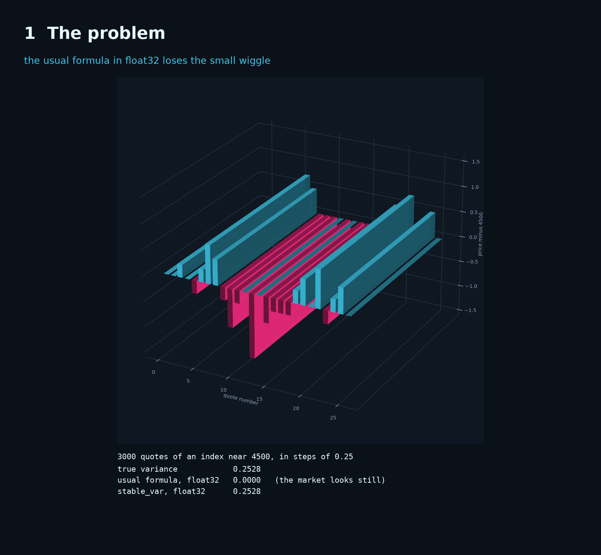
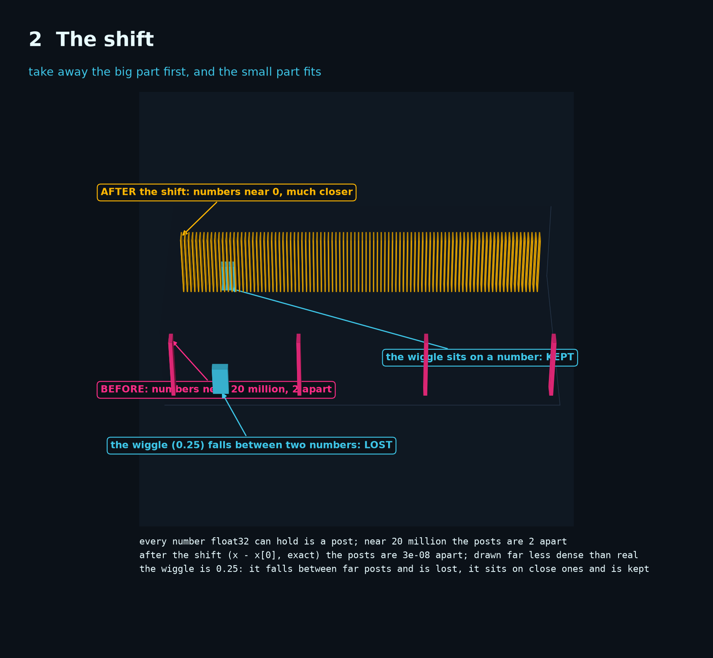
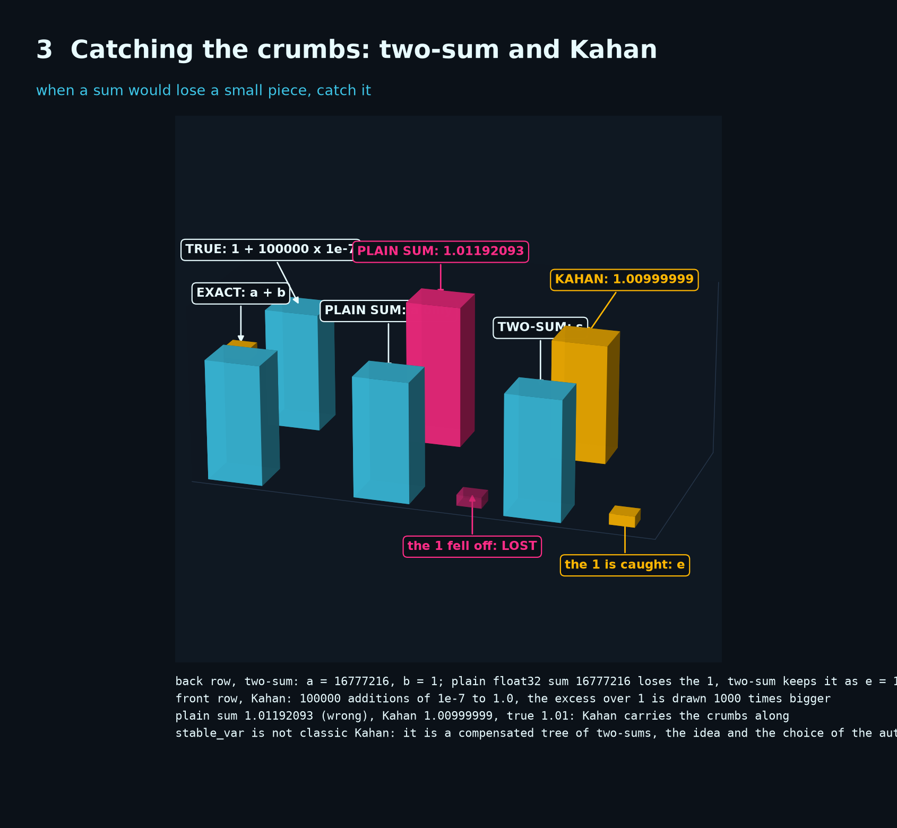
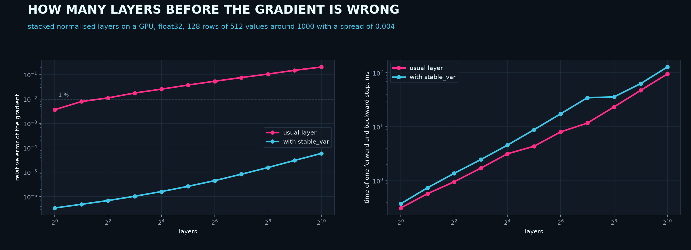
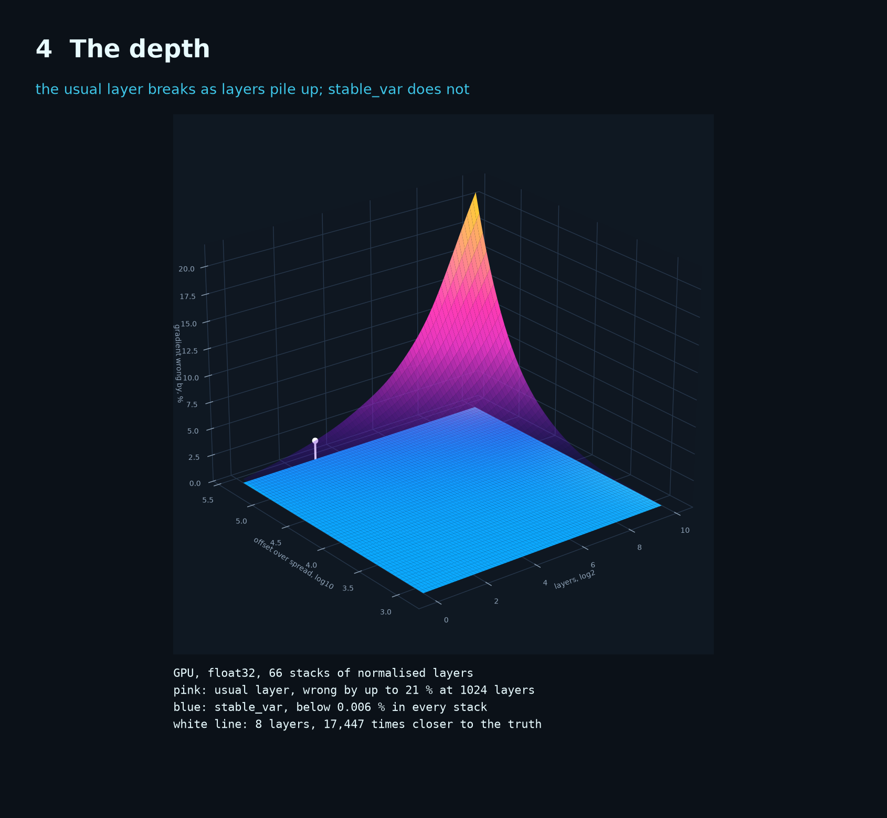

# Variance in float32 with a first-element shift, a local centring and a compensated tree sum

Salvatore Pennacchio, November 2026.

## Abstract

The variance of float32 data with a large offset and a small wobble loses its digits in the subtraction of two almost equal numbers: on 3000 values around 10⁶ with a spread of 1, the one-pass formula `mean(x²) - mean(x)²` returns -196608 where the variance is 0.989742. We describe `stable_var`, a variance for float32 in four steps: a shift by the first element, a local centring, a sum of the squares by a binary tree of error-free `TwoSum` additions, and a two-term correction. It returns exactly `0.0` on identical values, up to `1e38` and on `complex64`. On four datasets, on a CPU and on a GPU, its maximum relative error is between 1.15·10⁻⁷ and 1.64·10⁻⁷, and it is at most equal to the error of the formula of `tf.nn.moments`, which has no shift, on three of the four datasets in each of the four combinations of backend and execution mode (eager, `jit`); it is worse on one dataset on the CPU and on one dataset on the GPU under `jit`, and we do not explain why. It costs 3.59 times the formula of `tf.nn.moments` on a CPU and 2.24 times on a GPU. On stacks of 1 to 1024 normalised layers on a GPU, the gradient of the stack with the usual layer normalisation is wrong by up to 21 %, and with `stable_var` by less than 0.006 % in each of 66 stacks. We state what was not measured.

## 1. The problem

The variance of a sample is the average of the squared distances from the mean, `Var(x) = (1/n) Σ (xᵢ - mean(x))²`. A robot joint reports its angle as a float32 every millisecond; the angle sits around a large offset, the wobble around it is small, and the controller needs the variance of the wobble. The one-pass formula `mean(x²) - mean(x)²` subtracts two numbers of the order of `mean(x)²` to get a number of the order of the wobble squared, and the float32 mantissa is not wide enough.

We take 3000 float32 values from a normal distribution of mean 10⁶ and standard deviation 1 (seed 0). The float64 variance of the same float32 values is 0.989742; the one-pass formula in float32 gives -196608.000000. The two terms are of the order of `10¹²`, their rounding errors of the order of `10⁵`, a million times the wobble.

The same failure on a stock index quoted near 4500 in steps of 0.25 (3000 values, float32): the true variance is 0.2528, the usual formula returns 0.0000, as if the market stood still, and `stable_var` returns 0.2528.

*Figure 1. The problem.*

## 2. Related work

Chan, Golub and LeVeque [1] survey the algorithms for the sample variance with their round-off error bounds, including an analysis of the computation on shifted data: even a crude estimate of the mean used as a shift gives a large gain in accuracy without a first pass. Healy [3], for the mean and the variance in Monte-Carlo simulations, takes the first observation as the shift `K`, sums with Kahan's compensation and applies the two-term formula `T/n - (M - K)²`; his Algorithm 2 is the shifted naive algorithm with Kahan summation. The shift is exact when the values are within a factor of two of it (Sterbenz; Lemma 5 of [4]).

The compensated sum uses `TwoSum` of Knuth, which returns the rounded sum of two floating-point numbers and its exact rounding error [2, Algorithm 3.1]; see also Theorem 7 of [4].

This kernel adds to the algorithm of [3] the local centring `d = y - m` before the squares, a compensated binary tree, from Kahan's compensation, where each merge uses `TwoSum` [2, 4], in place of the sequential Kahan sum, and the evaluation one slice at a time with `vmap`. The tree has `log₂(n)` vectorised levels, so it runs on a GPU.

### The TwoSum against the papers

The function `_two_sum` of the kernel is Knuth's TwoSum, the same three lines as Algorithm 3.1 of [2] and as TWO-SUM, Theorem 7, of [4]: `x = fl(a + b)`, `z = fl(x - a)`, `y = fl((a - (x - z)) + (b - z))`, with `a + b = x + y` exactly. In this the kernel is not different from the papers. What is different is how it is used. Kahan summation [3] and the cascaded summation of [2], Algorithm 4.1, run along the elements in a loop: the second keeps one running sum of the errors, `sigma_i = fl(sigma_(i-1) + q_i)`, and the Kahan-Babuska algorithm is the same with FastTwoSum in place of TwoSum. The kernel adds the pieces in a binary tree of `log₂(n)` levels, and at each level, for every pair of partial sums `(S, C)`, it calls TwoSum three times, on the high parts, on the carries and on their sum; the new carry is `e1 + e2 + e3`. In the text of [2] and [3] there is no tree of TwoSum, and [2] cites parallel summation only in its list of references. The error analysis of [2] is for the sequential algorithms; for the tree we found no proof in the papers, and the carries `e1 + e2 + e3` are added with ordinary floating-point additions, so its accuracy is shown here by measurements. The compensated tree is the idea and the choice of the author, and it is not classic Kahan summation.

The baseline in the tests is the formula of `tf.nn.moments` in TensorFlow [5], `mean(d²) - mean(d)²` with `d = x - mean(x)`, which has no shift. An issue of TensorFlow reports its inaccuracy in float32 [6].

## 3. The kernel

`stable_var` returns the variance in the input dtype, with the `axis`, `ddof` and `keepdims` arguments of the other reducers of the library. Four steps, all in the input dtype.

1. **Shift.** Subtract the first element along the reduction axis, `y = x - x[0]`. When the values are within a factor of two of it, the subtraction is exact, and the large common exponent is gone. For `[1000.0, 1000.01, 1000.02]` in float32 the shifted values are `[0, 0.01000977, 0.02001953]`.
2. **Local centring.** The mean `m` of the shifted values is at the level of the wobble, and so is its rounding error, not at the level of the offset.
3. **Compensated tree.** The residuals `d = y - m` are formed and `s2 = Σ d²` is accumulated by a binary tree. At each level the pairs of partial sums are added with `TwoSum`, and the rounding errors are carried up the tree.
4. **Two-term correction and division.** With `s1 = Σ d`, the biased variance is `max(s2/n - (s1/n)², 0)`, multiplied by `n / (n - ddof)`. The mean is `x[0] + m`.

*Figure 2. The shift.*

The idea of a carry that keeps the low-order bits can be shown with the sequential summation of Kahan [7], which is not the one the kernel uses. For the array `[1.0] + [1e-7] * 100000` in float32 the exact sum is 1.01; the sequential sum gives 1.01192093 (error 1.9·10⁻³) and the Kahan sum 1.00999999 (error 9.5·10⁻⁹).

*Figure 3. The TwoSum and the Kahan sum: with a = 16777216 and b = 1 the plain float32 sum is 16777216, and the TwoSum returns s = 16777216 and e = 1.*

The dtype policy: float32 in gives float32 out; float64 in gives float64 out when `jax_enable_x64` is on (off, JAX promotes to float32); float16 and bfloat16 are computed in float32 and returned in the input dtype; integers give float32; complex input gives the real `E|z - mean(z)|²`. `ddof = n` returns `nan` when the variance is positive and `0.0` when the values are identical.

The same path is on the estimators, through the `dtype` keyword of `RunningMoments`: on a float32 block of 500 values around 1000 with a spread of 0.01, `RunningMoments(dtype=np.float32)` gives a variance of 1.029553·10⁻⁴ against 1.029553·10⁻⁴ in float64, a relative difference of 4.91·10⁻⁹. The default `dtype=None` keeps the float64 result, bit for bit.

## 4. Experiments

The tests are those of the script `benchmarks/stable_variance_float32.py` of the library, which calls `dense_armor.core.signals.stats.stable.stable_var` itself. Three claims were declared in the first commit of the script and not changed after the run: (1) the kernel returns exactly `0.0` on every identical-values case, under `jit`; (2) on each of the four datasets its maximum relative error is at most the one of the baseline formula, in eager mode and under `jit`; (3) its time is at most 4.0 times the time of the baseline on a `[4096, 4096]` array, `axis=1`. The original target for the time was 2.0 times; it was not reached, and the threshold of 4.0 was chosen after the measurement.

The numbers of the CPU are in `benchmarks/stable_variance_float32.json` (JAX 0.11.1), the ones of the GPU in `benchmarks/stable_variance_float32_gpu.json` (JAX 0.12.0.1).

### 4.1 Identical values

The variance of identical values is exactly `0.0` for `1e10`, `7.5e10`, `1e15` and `1e38` in float32 and for `7.5e10` in `complex64`, on the CPU and on the GPU, under `jit`. The baseline formula gives `nan` at `1e38`. In the example `[1e10, 1e10, 1e10]` the result is the bit pattern `0x00000000`.

### 4.2 The four datasets

Maximum relative error against the float64 variance of the same float32 values, for the baseline formula of `tf.nn.moments` (base) and for `stable_var` (kernel), eager and under `jit`.

CPU:

| dataset | base eager | kernel eager | base jit | kernel jit |
|---|---|---|---|---|
| N(10³, 0.01), `[1000, 64]`, axis 0 | 1.44·10⁻⁷ | 1.17·10⁻⁷ | 1.18·10⁻⁷ | 1.17·10⁻⁷ |
| N(10⁴, 1), `[64, 1000]`, axis 1 | 1.59·10⁻⁷ | 1.15·10⁻⁷ | 1.59·10⁻⁷ | 1.15·10⁻⁷ |
| N(0, 1), `[1000, 64]`, axis 0 | 1.94·10⁻⁷ | 1.36·10⁻⁷ | 1.94·10⁻⁷ | 1.36·10⁻⁷ |
| N(10⁶, 1), `[1000, 64]`, axis 0 | 1.18·10⁻⁷ | **1.22·10⁻⁷** | 0.997·10⁻⁷ | **1.22·10⁻⁷** |

GPU:

| dataset | base eager | kernel eager | base jit | kernel jit |
|---|---|---|---|---|
| N(10³, 0.01), `[1000, 64]`, axis 0 | 1.35·10⁻⁷ | 1.17·10⁻⁷ | 1.35·10⁻⁷ | 1.17·10⁻⁷ |
| N(10⁴, 1), `[64, 1000]`, axis 1 | 1.70·10⁻⁷ | 1.15·10⁻⁷ | 1.70·10⁻⁷ | 1.15·10⁻⁷ |
| N(0, 1), `[1000, 64]`, axis 0 | 1.44·10⁻⁷ | 1.36·10⁻⁷ | 1.44·10⁻⁷ | **1.64·10⁻⁷** |
| N(10⁶, 1), `[1000, 64]`, axis 0 | 1.25·10⁻⁷ | 1.22·10⁻⁷ | 1.25·10⁻⁷ | 1.22·10⁻⁷ |

Claim 2 holds on the GPU in eager mode and fails there under `jit` (the dataset N(0, 1)), and fails on the CPU in both modes (the dataset N(10⁶, 1)). In bold, the cases in which the kernel is worse than the baseline: by 3 % (N(10⁶, 1), eager, CPU), 22 % (the same under `jit`) and 14 % (N(0, 1), `jit`, GPU). Where the kernel is better, the error is lower by up to 32 %.

### 4.3 The speed

A synthetic `[4096, 4096]` float32 array, `axis=1`, under `jit`, 15 runs after warm-up with `block_until_ready`, the median of each of three sessions on the CPU. The ratio is the median of the medians of the kernel over the median of the medians of the baseline.

| | naive two-pass | base | kernel | kernel / base | range over the sessions |
|---|---|---|---|---|---|
| CPU | 51.4 ms | 57.7 ms | 207.4 ms | 3.59 | 3.55 to 4.60 |
| GPU | 0.706 ms | 0.696 ms | 1.558 ms | 2.24 | 2.20 to 2.27 |

The kernel costs 3.59 times the baseline formula on the CPU and 2.24 times on the GPU. The target of 2.0 times was not reached. On the CPU the upper end of the range comes from the first session of the kernel (median 264.9 ms), the other two being 205.2 and 207.4 ms.

### 4.4 The depth: a stack of normalised layers on a GPU

The script `benchmarks/stable_variance_depth.py` of the library stacks layers of the form `x <- OFFSET + SPREAD * tanh(LN(x) @ W)`, with `W` orthogonal times 0.7, a batch of 128 rows of width 512, an offset of 1000, and two layer normalisations in float32: the usual one, `(x - mean) / sqrt(var + eps)` with `jnp.mean` and `jnp.var`, and the one with `stable_var`, in which the variance is the one of `stable_var` and the mean is subtracted on the data shifted by the first element. For each depth the gradient of `sum(c * x_L)` with respect to `x_0` is computed in float32 by `jax.grad` and, as a reference, in float64 by replaying the backward pass layer by layer on the same float32 inputs, so that the comparison isolates the error of the backward pass. The matrix products use the highest precision, so that the layer normalisation is the only difference. The runs were made on a Kaggle GPU session with JAX 0.11.1 (`benchmarks/stable_variance_depth_gpu.json`, `benchmarks/stable_variance_depth_grid_gpu.json`).

With a spread of 0.004, 11 depths from 1 to 1024 layers, median time of 11 runs:

| layers | gradient error, usual | gradient error, `stable_var` | time, usual | time, `stable_var` | time ratio |
|---|---|---|---|---|---|
| 1 | 3.66·10⁻³ | 3.45·10⁻⁷ | 0.31 ms | 0.37 ms | 1.20 |
| 2 | 7.87·10⁻³ | 4.88·10⁻⁷ | 0.57 ms | 0.74 ms | 1.29 |
| 4 | 1.11·10⁻² | 6.95·10⁻⁷ | 0.96 ms | 1.37 ms | 1.43 |
| 8 | 1.77·10⁻² | 1.04·10⁻⁶ | 1.71 ms | 2.46 ms | 1.44 |
| 16 | 2.54·10⁻² | 1.62·10⁻⁶ | 3.15 ms | 4.56 ms | 1.45 |
| 32 | 3.74·10⁻² | 2.65·10⁻⁶ | 4.36 ms | 8.83 ms | 2.03 |
| 64 | 5.35·10⁻² | 4.54·10⁻⁶ | 8.05 ms | 17.42 ms | 2.17 |
| 128 | 7.58·10⁻² | 8.33·10⁻⁶ | 11.71 ms | 34.56 ms | 2.95 |
| 256 | 1.06·10⁻¹ | 1.56·10⁻⁵ | 23.34 ms | 35.78 ms | 1.53 |
| 512 | 1.50·10⁻¹ | 3.06·10⁻⁵ | 47.30 ms | 63.16 ms | 1.34 |
| 1024 | 2.04·10⁻¹ | 5.91·10⁻⁵ | 95.30 ms | 127.99 ms | 1.34 |

*Figure 4. The error of the gradient and the time of a step against the number of layers (spread 0.004).*

The same 11 depths with six values of the offset over the spread (66 stacks in all, 3 timed runs each), over the 11 depths of each row:

| offset / spread | error, usual | error, `stable_var` | times closer to the reference | time ratio |
|---|---|---|---|---|
| 250000 | 3.8·10⁻³ to 2.1·10⁻¹ | 3.3·10⁻⁷ to 6.0·10⁻⁵ | 3461 to 17447 | 1.12 to 3.09 |
| 79365 | 1.2·10⁻³ to 8.0·10⁻² | 3.2·10⁻⁷ to 1.1·10⁻⁵ | 3777 to 6949 | 1.29 to 3.10 |
| 25000 | 3.7·10⁻⁴ to 2.8·10⁻² | 3.4·10⁻⁷ to 2.9·10⁻⁵ | 962 to 2012 | 1.00 to 2.95 |
| 7937 | 1.1·10⁻⁴ to 7.5·10⁻³ | 3.2·10⁻⁷ to 3.9·10⁻⁵ | 192 to 647 | 1.05 to 2.11 |
| 2500 | 4.1·10⁻⁵ to 2.2·10⁻³ | 3.4·10⁻⁷ to 3.6·10⁻⁵ | 61 to 199 | 0.76 to 2.06 |
| 794 | 1.2·10⁻⁵ to 7.2·10⁻⁴ | 3.5·10⁻⁷ to 1.7·10⁻⁵ | 35 to 67 | 1.23 to 2.36 |

The kernel is closer to the float64 reference in all 66 stacks, by a factor between 35 and 17447 (median 962). The usual layer degrades with the depth and with the offset over the spread, up to 21 % at 1024 layers and an offset over the spread of 250000; with `stable_var` the error stays below 0.006 %. No gradient is NaN or infinite. The time of a step with `stable_var` is between 0.76 and 3.1 times the time with the usual layer, with a median of 1.42: it is lower in 2 of the 66 stacks and higher in 64.

*Figure 5. The gradient of a stack of normalised layers: the usual layer rises to 21 %, the layer with `stable_var` stays on the floor, below 0.006 %.*

### 4.5 The cost in a network step

**The key point: in a complete neural network, the impact of stable_var on the total speed is almost null (only +1.5%), even if the isolated operation is slower.**

Here is the detailed explanation of the numbers and of their meaning:

**1. The context of the test**

The test simulates a small language model or a block of a neural network with these characteristics:

- 4096 tokens: the length of the processed sequence.
- Width 1024 and hidden 4096: the internal dimensions of the vectors and of the layers (typical architecture of the Feed-Forward blocks of Transformers).
- 8 layers: the depth of the tested network.
- Median of 7 runs: the test was repeated 7 times, taking the central value to avoid temporary distortions of the GPU.

**2. Analysis of the table (isolated computation against whole network)**

| | usual | with `stable_var` |
|---|---|---|
| forward and backward step | 458.9 ms | 465.6 ms |
| normalisation alone | 0.61 ms | 1.28 ms |
| share of the normalisation in the step | 1.1 % | 2.2 % |

- Normalisation alone (0.61 ms against 1.28 ms): taken alone, the version with stable_var takes about twice the time (2.1 times slower). It is the figure we had seen in the previous tests.
- Forward and backward step (458.9 ms against 465.6 ms): it is the time needed for a whole training cycle (forward + backward pass, that is calculation of the error and update of the weights). Here the difference is only 6.7 milliseconds (+1.45%, rounded to 1.5%).
- Share of the normalisation (1.1% against 2.2%): in a real network, the bulk of the computational work is done by the matrix multiplications (the linear layers). The normalisation takes a tiny slice of the total time. Even doubling its cost, its weight on the total goes from 1.1% to 2.2%: a negligible impact.

**3. What it means for the training**

- "The gradient is finite": it means that the calculations did not "explode" producing mathematical errors (NaN or infinity), confirming the numerical stability in both tests.
- The practical confirmation: the slowdown (up to 3x) measured by isolating the single layer is not a problem in practice, because it is "absorbed" by the other, much heavier, calculations of the network.

## 5. Declared limits

- The accuracy is at most equal to the baseline formula on three of the four datasets in each combination of backend and mode. It is worse on N(10⁶, 1) on the CPU, in eager mode and under `jit`, and on N(0, 1) under `jit` on the GPU. The cause is not explained.
- The speed is 3.59 times the baseline on the CPU and 2.24 times on the GPU; the threshold of 4.0 was chosen after the measurement.
- Not measured: float64 (`[1e307]*3`), TPU, other array sizes.
- The baseline of the tests has no shift: there is no comparison with a shifted baseline.
- `stable_var` is a function, not an estimator: it has no `learn_one`, no `budget_s`, no `memory_class`.
- The 1965 paper of Kahan [7] is bibliographic only, not read.
- The depth test is one synthetic stack of layers, not a trained network; it was run in one GPU session (the session saw two devices), with 11 timed runs per depth in the first table and 3 in the second.
- The time ratio of 2.95 at 128 layers is out of line with its neighbours (2.17 and 1.53) and was not investigated.
- The accuracy of the compensated tree is shown by measurements; the papers have no proof for it.

## 6. Reproduction

`python benchmarks/stable_variance_float32.py` in the library writes `benchmarks/stable_variance_float32.json` with the backend, the JAX version and the sessions of the speed measurement. The GPU numbers were obtained with the same script. As a check, the script was run again on a Kaggle GPU session with JAX 0.11.1, with `stable.py` and the script taken unchanged from the library: the accuracy numbers are equal to the ones of `stable_variance_float32_gpu.json` to all the digits, the claims are the same, and the speed ratio is 2.22 (range 2.18 to 2.25). The depth test is `python benchmarks/stable_variance_depth.py` (the first table) and `python benchmarks/stable_variance_depth.py --grid` (the second) in the library, run on a Kaggle GPU session. The figures are drawn by `docs/assets/stable_variance/make_explained.py` and `make_depth_figure.py` of the library from those results. The code blocks of the documentation page of `stable_var` were run with the function and their printed outputs are the ones shown there.

## References

1. T. F. Chan, G. H. Golub, R. J. LeVeque. *Algorithms for Computing the Sample Variance: Analysis and Recommendations.* The American Statistician 37(3), 242-247, 1983.
2. T. Ogita, S. M. Rump, S. Oishi. *Accurate Sum and Dot Product.* SIAM Journal on Scientific Computing 26(6), 1955-1988, 2005. Algorithm 3.1 (`TwoSum`).
3. J. Healy. *Accurate and consistent calculation of the mean and variance in Monte-Carlo simulations.* arXiv:2206.10662v7, 2022. Algorithm 2.
4. J. R. Shewchuk. *Adaptive Precision Floating-Point Arithmetic and Fast Robust Geometric Predicates.* Discrete and Computational Geometry 18(3), 305-363, 1997. Theorem 7 (`Two-Sum`); Lemma 5 (Sterbenz).
5. TensorFlow, `tensorflow/python/ops/nn_impl.py`, function `moments`, lines 1480-1487 (master, read on 2026-10-29).
6. TensorFlow, issue #117286: the inaccuracy of `tf.nn.moments` in float32.
7. W. Kahan. *Further remarks on reducing truncation errors.* Communications of the ACM 8(1), 40, 1965.
